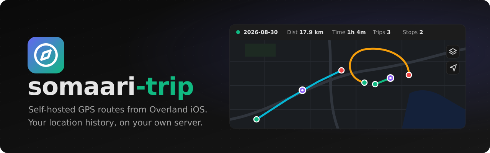
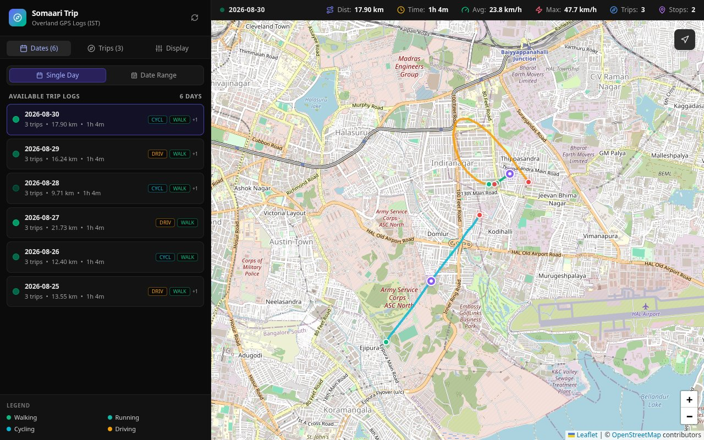
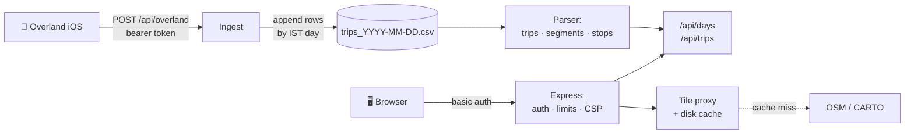

<div align="center">



<br>

**See where you've been, on a map that only you can open.**<br>
Overland on your iPhone uploads straight to your own server. Routes, stops and stats are drawn
from plain daily CSV files: no cloud, no database, no API keys.

<br>

[](https://nodejs.org/)
[](https://www.typescriptlang.org/)
[](https://react.dev/)
[](https://leafletjs.com/)
[](#-install)
[](https://www.raspberrypi.com/products/raspberry-pi-5/)
[](LICENSE)

[Features](#-features) ·
[Install](#-install) ·
[Usage](#-usage) ·
[How it works](#-how-it-works) ·
[Privacy](#-privacy) ·
[Security](#%EF%B8%8F-security-model) ·
[API](#-api) ·
[Development](#%EF%B8%8F-development) ·
[Guide](docs/GUIDE.md)

</div>



> [!WARNING]
> This is your precise location history. Keep the app on your home network or a private network
> (ZeroTier, Tailscale, WireGuard) and **never port-forward it to the internet.**
> See [Who can reach it](docs/GUIDE.md#who-can-reach-it).

---

## ✨ Features

- 📱 **Straight from Overland**: the iPhone app posts batches to your server with a token. Points
  are written to disk before Overland is told "ok", so nothing is lost if anything fails.
- 🗺️ **Trips and stops**: routes split into trips, gaps over 5 minutes shown as separate
  segments, stops detected where you stayed put, with WiFi network and battery level.
- 🎨 **Colour by mode or speed**: walking, cycling, driving and more, or a green → red speed
  gradient. Grey where the phone didn't report a speed.
- 📅 **Days and ranges**: one day, a custom range, or the past 3 / 7 / all days, with totals for
  distance, time, speed, trips and stops.
- 🎯 **Accuracy filter**: hide jittery GPS points with a slider (10 to 100 m).
- 🕰️ **IST throughout**: days run midnight to midnight IST, and every time is shown in IST.
- 🔒 **Private map tiles**: the server fetches and caches OpenStreetMap / CARTO tiles, so tile
  providers never see your browser.
- 📲 **Works on a phone**: the sidebar folds away into a menu.
- 🪶 **Light on the Pi**: one container and one Node process, ~60–100 MB of RAM, a ~120 MB image,
  and memory that doesn't grow with years of history.

> [!NOTE]
> No accounts, no API keys, no third-party services. The only things outside your network are
> the map tile servers, and only your server talks to them.

## 🚀 Install

You need a Linux machine that stays on (Raspberry Pi 5 or any x86_64 server), Docker with the
Compose plugin, and Overland on your iPhone. The [guide](docs/GUIDE.md) covers the rest:
- [Install with Docker](docs/GUIDE.md#install-with-docker) and
  [who can reach it](docs/GUIDE.md#who-can-reach-it) (LAN, ZeroTier/Tailscale, reboots)
- [Settings](docs/GUIDE.md#settings): every `.env` option and its default
- [Login](docs/GUIDE.md#login): creating and changing the password
- [Overland (iPhone)](docs/GUIDE.md#overland-iphone): app settings and checking uploads arrive
- [Data files](docs/GUIDE.md#data-files): CSV format, ownership, backups
- [Updating](docs/GUIDE.md#updating) and [trying it with sample data](docs/GUIDE.md#try-it-with-sample-data)

## 🧑‍💻 Usage

| Do this… | What happens |
|---|---|
| Click a day in **Dates** | Its routes, stops and totals load, and the map zooms to fit |
| **Date Range** → **Past 7 Days** | Every trip in the range on one map, with combined totals |
| Click a trip in **Trips** | It's highlighted and zoomed to; the stats bar shows its mode |
| Click a purple stop | How long you stayed, when, the WiFi network and battery level |
| **Display** → **By Speed** | Routes coloured green → red by speed, with a legend |
| **Display** → **Filter By Mode** | Only walking, only driving, … everywhere on the page |
| Layers button on the map | OpenStreetMap, CartoDB Dark or Voyager (remembered) |
| **↻** next to the title | Loads points uploaded since you opened the page |

Everything else, with screenshots: [Using the app](docs/GUIDE.md#-using-the-app).

## 🧠 How it works



<details>
<summary><b>Step by step</b></summary>

<br>

Everything runs in **one container, one Node process** (Express; no nginx, no database),
published on `SOMAARI_TRIP_BIND:SOMAARI_TRIP_PORT` (default `127.0.0.1:18473`).

1. **Phone (Overland iOS)** logs GPS points in the background and POSTs them in batches (JSON
   `locations` array) to `/api/overland`, with a bearer token, over your LAN or a private network.
2. **Ingest** (only when `OVERLAND_TOKEN` is set; token instead of basic auth, 5 MB body limit,
   own rate limit) buckets each point by its **IST** date and appends rows to
   `trips_YYYY-MM-DD.csv`, writing the header for a new file. It replies only after the rows are
   on disk; on failure it returns 500 so Overland keeps the batch and retries.
3. **Storage** is plain CSV files on disk, one per IST day: no database.
4. **API**:
   - Parses CSVs, drops bad rows and points with accuracy worse than 50 m (adjustable), and
     treats `speed=-1` as unknown rather than stopped. Day summaries are cached per file until it
     changes, and parsed points sit in a capped LRU (~100k points), so memory doesn't grow with
     history.
   - Groups points by `trip_id`, splits trips on gaps over 5 minutes, detects stops (3+
     consecutive stationary points), and computes distance, duration and speeds.
   - Days are **IST days**, and files are named by IST date, so day D is read from file D alone.
     A trip crossing midnight is split between both days.
5. **Web**: basic auth on everything except `/api/overland` and `/api/health`; serves the built
   React app (precompressed `.br`/`.gz`, hashed assets cached `immutable`); proxies `/tiles/` to
   OSM/CARTO with a disk cache (`tile-cache` volume, 1 GB cap); security headers, a strict CSP and
   per-IP rate limits.
6. **Browser** (React + Leaflet) loads the day list, then that day's trips and stops, and draws
   them in IST. It only ever talks to your server.

</details>

## 🔒 Privacy

> [!IMPORTANT]
> **TL;DR:** your location history stays on your server, in files you own. The phone uploads
> only to your server, the browser only talks to your server (enforced by the CSP), and there's
> no analytics or telemetry. Map tiles are the one outside request, made by the server.

<details>
<summary><b>What leaves your server, and what doesn't</b></summary>

<br>

- **Overland** sends points only to the URL you configure: your server.
- **The browser** loads the app, the API and map tiles from your server only. The production CSP
  allows `'self'` and nothing else, so no fonts, scripts or trackers load from elsewhere.
- **Map tiles**: on a cache miss, the server fetches the tile from OpenStreetMap or CARTO with
  only `User-Agent` and `Accept` headers. The provider sees your server's IP and which map tiles
  were requested (which reveals the areas viewed), never your browser, cookies or location
  points. Cached tiles are reused for 30 days.
- **Not stored anywhere else:** no database, no copies. Back up `DATA_DIR` to back up your
  history, and encrypt it at rest (gocryptfs, LUKS) if the machine could be physically accessed.
- **Dev mode** (`npm run dev`) fetches tiles from the browser directly; use it with sample data.

</details>

## 🛡️ Security model

| Layer | Protection |
|---|---|
| 🔑 **Login** | Basic auth (scrypt hash in `.env`) on every route that reads data. The app won't start in production without it |
| 📮 **Overland** | Its own bearer token, compared in constant time, 5 MB body limit |
| 🚦 **Limits** | Per-IP rate limits and server timeouts; wrong passwords are limited before scrypt runs |
| 🧱 **Container** | Non-root user, read-only root filesystem, all capabilities dropped, `no-new-privileges` |

<details>
<summary><b>Details</b></summary>

<br>

There's no reverse proxy in front: Express does the login, limits and headers itself.
- **Login**: basic auth is checked before any route that reads data, with a constant-time
  compare. Wrong passwords have their own rate limit, checked before scrypt runs, and a header
  that verified once is remembered so scrypt runs once per session.
- **Limits**: per-IP token buckets (10 r/s burst 20 for `/api/`, 2 r/s burst 10 for
  `/api/overland`), 5 MB Overland body limit, server timeouts (headers 10 s, request 30 s,
  keep-alive 5 s).
- **Headers**: strict CSP (`'self'` only), `X-Content-Type-Options`, `X-Frame-Options`,
  `Referrer-Policy`, `Permissions-Policy`; no `X-Powered-By`.
- **Tile proxy**: allow-listed styles and integer `z/x/y` only, so it can't be used as an open
  proxy; only `User-Agent` and `Accept` go upstream, never browser headers.
- **Container**: runs as uid `INGEST_UID` (default 1001). The data dir is writable because ingest
  appends to it; only the CSV append code writes there, and dates are regex-validated before any
  file path is built.
- **Network**: plain HTTP, meant for a LAN or an encrypted private network; see
  [Who can reach it](docs/GUIDE.md#who-can-reach-it).

</details>

## 🔌 API

| Endpoint | Returns |
|---|---|
| `GET /api/days` | Every day with data: date, points, distance, duration, trips, modes, stops |
| `GET /api/trips?date=YYYY-MM-DD` | That day's trips (GeoJSON lines, split at gaps over 5 min) and stops |
| `GET /api/trips?from=…&to=…` | The same for a range of days |
| `…&max_accuracy=50` | Drops points less accurate than this many metres (default 50) |
| `GET /api/health` | `{"status":"ok", …}`, no login needed |
| `POST /api/overland` | Overland batch upload (bearer token, not the login). 401 bad token, 400 no `locations` array, `{"result":"ok"}` once on disk |

All but `/api/health` and `/api/overland` need the login. CSV columns:
[Data files](docs/GUIDE.md#data-files).

## 🛠️ Development

```sh
npm ci
SEED_SAMPLE_DATA=true npm run dev   # API + Vite on 127.0.0.1:3000, sample data in ./data, no login
npm run lint                        # tsc --noEmit
npm test                            # vitest
npm run build                       # frontend + bundled server into dist/
```

The dev server reads `./data` and fetches map tiles directly; production serves `dist/` and
proxies tiles. `AUTH_USER`/`AUTH_HASH` in the shell turn the login on in dev too. Built with
TypeScript, Express, React, Leaflet, Tailwind CSS and PapaParse. Screenshots in `docs/images/`
are taken from sample data only, never real location history.

## License

MIT, see [LICENSE](LICENSE).

<div align="center">
<br>
<sub>Made for a Raspberry Pi 5 that knows where you've been, and tells no one else.</sub>
</div>
