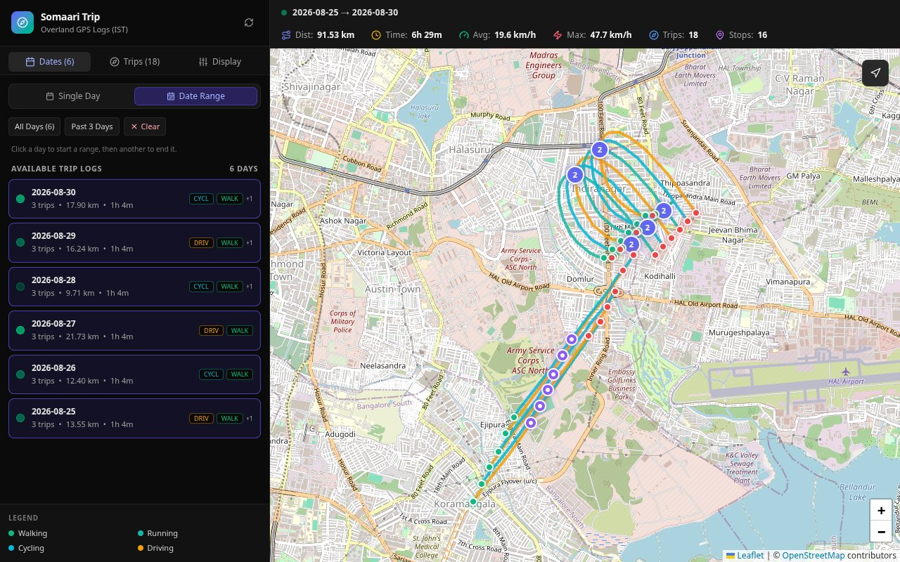
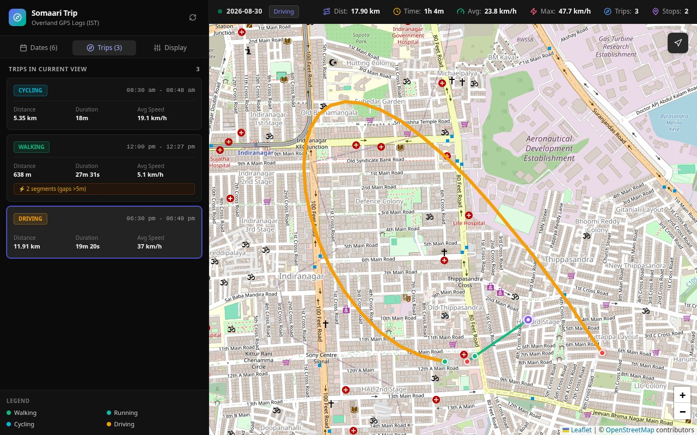
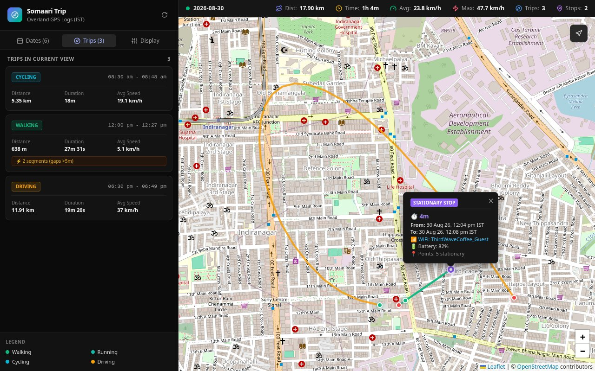
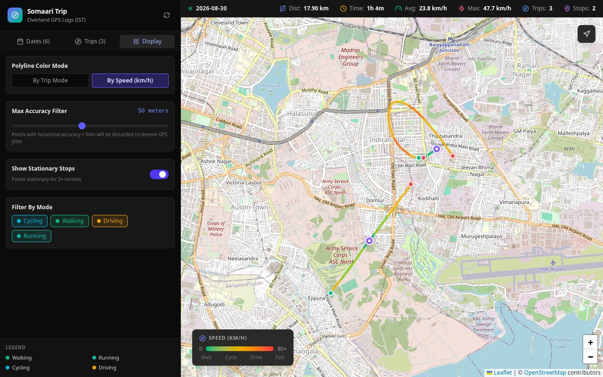
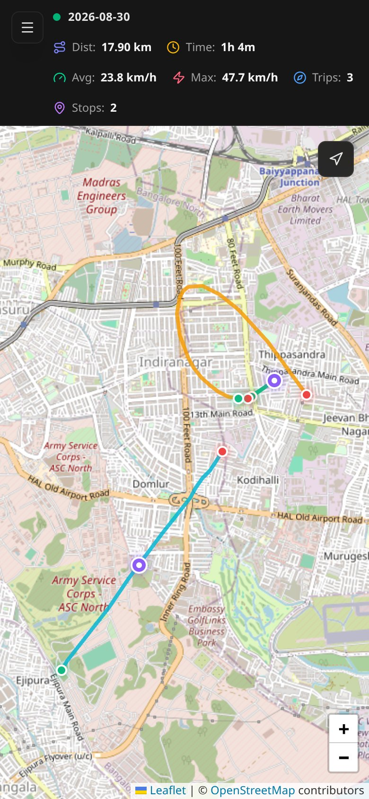
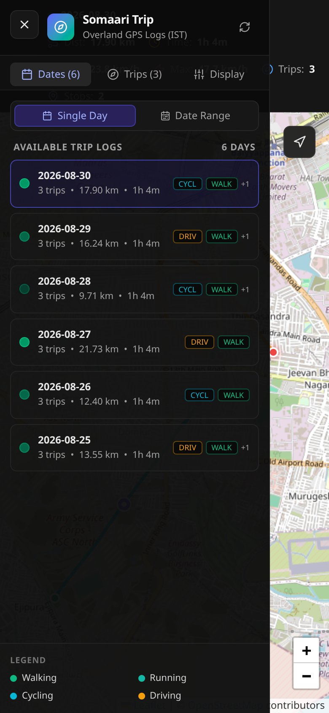

<div align="center">


<br>

**The somaari-trip guide: install it, connect your phone, find your way around the map.**<br>
For how it works inside, privacy, security, the API and development, see the [README](../README.md).

<br>

[Installation](#-installation) ·
[Configuration](#%EF%B8%8F-configuration) ·
[Using the app](#-using-the-app) ·
[Troubleshooting](#-troubleshooting) ·
[README](../README.md)

</div>


> [!NOTE]
> All screenshots use the built-in sample data, not real location history.

<details>
<summary><b>Contents</b></summary>

<br>

- 🚀 [Installation](#-installation): [Requirements](#requirements) ·
  [Install with Docker](#install-with-docker) · [Who can reach it](#who-can-reach-it) ·
  [Updating](#updating) · [Try it with sample data](#try-it-with-sample-data)
- ⚙️ [Configuration](#%EF%B8%8F-configuration): [Settings](#settings) · [Login](#login) ·
  [Overland (iPhone)](#overland-iphone) · [Data files](#data-files)
- 🧭 [Using the app](#-using-the-app): [Signing in](#signing-in) · [The screen](#the-screen) ·
  [Picking a day](#picking-a-day) · [Several days at once](#several-days-at-once) ·
  [Trips](#trips) · [Reading the map](#reading-the-map) · [Stops](#stops) ·
  [Display settings](#display-settings) · [Map controls](#map-controls) ·
  [On a phone](#on-a-phone) · [Times and days](#times-and-days)
- 🩺 [Troubleshooting](#-troubleshooting)

</details>

---

## 🚀 Installation

### Requirements

| You need | Why |
|---|---|
| 🖥️ A Linux machine that stays on | A **Raspberry Pi 5** (ARM64) or any x86_64 home server. About 100 MB of RAM, a 120 MB image and up to 1 GB for the map tile cache |
| 🐳 **Docker** with the Compose plugin | Runs the app (`docker compose`) |
| 🟩 **Node.js 20+** | Only to create the login hash. Or run `npm run hash-password` on any other machine and copy the two lines it prints |
| 📱 **Overland** for iOS | Records your location and uploads it |
| 🔗 A network the phone can reach the server on | Your home wifi, or ZeroTier / Tailscale so it also works away from home |

### Install with Docker

```sh
# 1. Get the code
git clone https://github.com/ashwinkrpi/somaari-trip.git
cd somaari-trip

# 2. Where the daily CSV files live (default ./data)
echo "DATA_DIR=/path/to/gps-logs" >> .env

# 3. Login (required: the app won't start without it). Prompts for the password
npm ci
npm run -s hash-password -- <user> >> .env

# 4. Who can reach it (default 127.0.0.1: this machine only). See "Who can reach it"
echo "SOMAARI_TRIP_BIND=0.0.0.0" >> .env

# 5. Token for Overland uploads (required, even if you don't use Overland yet)
echo "OVERLAND_TOKEN=$(openssl rand -hex 32)" >> .env

# 6. Build and start
docker compose up -d --build
```

Then open **`http://<server-ip>:18473`** and sign in. `<server-ip>` is any address of the server
that your device can reach: its LAN IP at home, its ZeroTier/Tailscale IP from anywhere. The
container restarts by itself after crashes and reboots.

> [!NOTE]
> If `DATA_DIR` isn't owned by uid 1001, also set `INGEST_UID` / `INGEST_GID` to its owner (see
> [Data files](#data-files)).

### Who can reach it

`SOMAARI_TRIP_BIND` decides which of the server's network addresses the app listens on:

| Value | Reachable from |
|---|---|
| `127.0.0.1` (default) | 🔒 the server itself only |
| `0.0.0.0` | 🏠 every network the server is on: home LAN and ZeroTier/Tailscale |
| one IP, e.g. the ZeroTier IP | 🔗 only that network |

> [!WARNING]
> **Never port-forward the port on your router.** Docker-published ports bypass `ufw`, so the
> router is what keeps it off the internet. For access away from home use ZeroTier, Tailscale or
> WireGuard.

- **With `0.0.0.0`**, anyone on your LAN can reach the login page, and on the LAN the password
  travels as plain HTTP (ZeroTier/Tailscale encrypt their link). Fine on a home network you trust.
  Give the server a DHCP reservation on the router so its LAN IP doesn't change.
- **With a single ZeroTier/Tailscale IP, reboots can break it.** Docker can start before that
  network is up; the container then fails with "cannot assign requested address" and stays down
  until you run `docker compose up -d`. Overland keeps unsent points and retries, so nothing is
  lost. `0.0.0.0` avoids this.

<details>
<summary><b>Keeping a single VPN IP across reboots</b> (both need sudo, then a reboot to confirm)</summary>

<br>

- **sysctl (simplest):**
  `echo 'net.ipv4.ip_nonlocal_bind=1' | sudo tee /etc/sysctl.d/99-nonlocal-bind.conf && sudo sysctl --system`
  lets programs listen on an IP before it exists. It doesn't change routing, firewall or what's
  exposed; a mistyped bind IP just no longer errors.
- **Docker waits for the IP:** a systemd drop-in for `docker.service` with
  `After=zerotier-one.service` and an `ExecStartPre` that waits (with a timeout) for the IP. Every
  container then starts a little later.

</details>

### Updating

```sh
git pull
docker compose up -d --build
```

Your `.env`, CSV files and tile cache are kept.

### Try it with sample data

To look around without a phone or real data, run the development server on generated sample days
(needs Node, not Docker):

```sh
npm ci
SEED_SAMPLE_DATA=true npm run dev
```

Open `http://localhost:3000`. It writes six sample days to `./data` if that folder is empty, needs
no login, and only listens on the machine itself.

---

## ⚙️ Configuration

### Settings

Docker Compose reads these from `.env` next to `docker-compose.yml` (see `.env.example`).

| Setting | Default | What it does |
|---|---|---|
| `AUTH_USER`, `AUTH_HASH` | none (required) | Login for the web app. Create with `npm run hash-password`, see [Login](#login) |
| `OVERLAND_TOKEN` | none (required) | Shared secret the phone sends with uploads. `openssl rand -hex 32` |
| `DATA_DIR` | `./data` | Folder on the server with the daily CSV files. Mounted read-write: uploads are appended here |
| `SOMAARI_TRIP_BIND` | `127.0.0.1` | Address to listen on, see [Who can reach it](#who-can-reach-it) |
| `SOMAARI_TRIP_PORT` | `18473` | Port on the server |
| `INGEST_UID`, `INGEST_GID` | `1001` | User and group the app runs as. Set to the owner of `DATA_DIR` so new files keep the same owner |

> [!IMPORTANT]
> After changing any of them run `docker compose up -d`. `docker compose restart` doesn't pick
> up `.env` changes.

`SEED_SAMPLE_DATA` only applies to `npm run dev` and has to be set in the shell, as in
[Try it with sample data](#try-it-with-sample-data); Docker ignores it.

### Login

The app uses one username and password, checked by the browser's own sign-in prompt. `.env`
stores a scrypt hash, never the password.

- **Create it:** `npm run -s hash-password -- <user> >> .env` asks for the password twice (at
  least 12 characters) and appends `AUTH_USER` and `AUTH_HASH`.
- **Change it:** delete the old `AUTH_USER` and `AUTH_HASH` lines from `.env`, run the command
  again, then `docker compose up -d`.

### Overland (iPhone)

In Overland's settings:

| Setting | Value |
|---|---|
| **Receiver Endpoint / Server URL** | `http://<server-ip>:18473/api/overland`. Use the ZeroTier/Tailscale IP so uploads also work away from home |
| **Access Token** | The `OVERLAND_TOKEN` value from `.env`. Overland sends it as `Authorization: Bearer` (`?token=` in the URL also works but ends up in logs) |
| **Tracking** | Continuous, accuracy Best. Visits off, pause off |

Plain HTTP is fine over ZeroTier/Tailscale, which encrypt the link. Overland uploads in batches;
the app only answers once the points are on disk, and on any error Overland keeps the batch and
retries later.

> [!TIP]
> **Check it works:** after a short trip, today's file `trips_YYYY-MM-DD.csv` should appear or
> grow in `DATA_DIR`, and pressing **↻** in the app shows the trip. `docker logs somaari-trip`
> shows errors, if any.

### Data files

Each day is one CSV file in `DATA_DIR`, named `trips_YYYY-MM-DD.csv` by its **IST** date. The app
creates and appends to them; you can also copy in files from elsewhere, as long as they use the
same name pattern and columns. The files must be writable by `INGEST_UID`/`INGEST_GID` (default
1001); check the owner with `ls -ln "$DATA_DIR"`.

> [!TIP]
> There's no database: back up the folder to back up your history, and encrypt it at rest
> (gocryptfs, LUKS) if the machine could be physically accessed.

<details>
<summary><b>CSV columns</b></summary>

<br>

```csv
timestamp,trip_id,lat,lon,speed_mps,speed_accuracy,course,course_accuracy,altitude_m,vertical_accuracy,accuracy_m,battery_level,battery_state,motion,wifi_ssid,device_id,trip_distance_m,trip_mode,trip_start
```

| Column | Meaning |
|---|---|
| `timestamp` | ISO 8601 UTC, e.g. `2026-08-30T03:30:00.000Z`. Shown in IST |
| `trip_id` | Groups points into one trip |
| `lat`, `lon` | Position in degrees |
| `speed_mps` | Speed in metres per second; `-1` means unknown |
| `accuracy_m` | Horizontal accuracy in metres. Points worse than the app's accuracy filter (default 50 m) are hidden |
| `battery_level` | 0 to 1, shown in stop popups |
| `wifi_ssid` | Network the phone was on, shown in stop popups |
| `motion` | Activity, e.g. `stationary`, `walking`, `cycling`, `automotive`, `running` (several joined with `;`) |
| `trip_distance_m` | Distance so far in the trip, in metres |
| `trip_mode` | e.g. `walking`, `driving`, `cycling`, `running`, `train` |
| the rest | `speed_accuracy`, `course`, `course_accuracy`, `altitude_m`, `vertical_accuracy`, `battery_state`, `device_id`, `trip_start`: stored as Overland sends them |

Commas and line breaks inside values are replaced (`;` and a space), so files never need quoting.

</details>

---

## 🧭 Using the app

### Signing in

Open `http://<server-ip>:18473` (or your `SOMAARI_TRIP_PORT`). The browser asks for a username
and password: the `AUTH_USER` and the password you gave `npm run hash-password`. The browser
remembers them until you close it. Mistyping the password many times in a row gets you briefly
rate limited; wait a few seconds and try again.

### The screen

| Part | What's there |
|---|---|
| **Sidebar** (left) | Three tabs, **Dates**, **Trips** and **Display**, and the colour legend for trip modes at the bottom |
| **Stats bar** (top) | What you're looking at (a day or a range), then total distance, total trip time, average and maximum speed, number of trips and number of stops |
| **Map** | Routes, start and end points, stops, and the map controls on the right |

> [!TIP]
> The app doesn't refresh by itself. Press **↻** next to the title to reload the day list and
> the current view with whatever Overland uploaded since you opened the page.

### Picking a day

The **Dates** tab lists every day that has data, newest first, and opens the newest day. Each row
shows the date, number of trips, distance and duration, plus badges for the travel modes that day
(`+1` means one more mode than fits). The dot on the left is brighter on days with more distance.

Click a day to show it on the map. The map zooms to fit that day's routes.

### Several days at once



Switch to **Date Range** at the top of the Dates tab, then either:
- use a preset: **All Days**, **Past 3 Days** or **Past 7 Days** (shown when there are enough
  days), or
- click a first day, then a last day. The days in between are included.

**Clear** removes the range. Switch back to **Single Day** for one day again. The stats bar and
the trip list cover the whole range.

### Trips



The **Trips** tab lists the trips in the current view with their mode, start and end time,
distance, duration and average speed.

- **Click a trip** to highlight it on the map and zoom to it. The stats bar shows its mode. Click
  it again to unselect it.
- **"N segments (gaps >5m)"** means the phone recorded nothing for more than 5 minutes during the
  trip (tunnel, phone off, no GPS). The route isn't drawn across the gap, so the trip shows as
  separate pieces.
- **Clicking a route on the map** selects that trip too. When routes are coloured by mode, it also
  opens a popup with distance, duration, average and maximum speed, and start and end time.

### Reading the map

| On the map | Meaning |
|---|---|
| Coloured line | A route, coloured by trip mode (see the legend) or by speed (see [Display settings](#display-settings)) |
| 🟢 Green dot | Where a trip starts. Hover for the time |
| 🔴 Red dot | Where a trip ends. Hover for the time |
| 🟣 Purple ring | A stop. A purple circle with a number is several stops close together |

### Stops



A stop is where the phone reported being stationary for at least 3 points in a row. Click one to
see how long you were there, from and to when, the WiFi network the phone was on (if Overland
reported one) and the battery level. Grouped stops list each stop in the group.

### Display settings



| Setting | What it does |
|---|---|
| 🎨 **Polyline Color Mode** | **By Trip Mode**: one colour per trip, from its mode. **By Speed (km/h)**: each stretch coloured from green (walking pace) through yellow to red (fast), with a legend at the bottom of the map. **Grey** means the phone didn't report a speed there. Hover over a stretch for its average speed and time |
| 🎯 **Max Accuracy Filter** | 10 to 100 m, default 50: drops GPS points less accurate than this. Lower it if routes zig-zag or jump around (indoors, between tall buildings); raise it if parts of a route are missing. Resets to 50 m on reload |
| 🟣 **Show Stationary Stops** | Hides or shows the stop markers |
| 🚲 **Filter By Mode** | Click a mode to show only trips of that mode; click more to add them. The stats bar, trip list and stops follow the filter. Click the selected modes again to unselect them; with none selected, everything is shown |

### Map controls

The map is OpenStreetMap. On the right of the map:
- **Arrow button** (Fit to Trips, top right): zoom back out to show every trip in the current
  view.
- **+ / −** (bottom right): zoom. You can also scroll, pinch, or drag the map.

In Docker, map tiles go through your server and are cached there, so OpenStreetMap never sees
your browser.

### On a phone

<div align="center">

&nbsp;&nbsp;

</div>

The sidebar is hidden on small screens. Tap the **☰** button (top left) to open it and **✕** to
close it. Picking a day closes it for you. Everything else works the same as on a computer.

### Times and days

> [!NOTE]
> All times are shown in **IST** (Asia/Kolkata, UTC+5:30), and a "day" is an IST calendar day,
> midnight to midnight. A trip that runs past midnight appears partly on each day.

---

## 🩺 Troubleshooting

**Installing and running**

<details>
<summary><b><code>docker compose</code> says <code>set AUTH_USER and AUTH_HASH</code> or <code>set OVERLAND_TOKEN</code></b></summary>

Those lines are missing from `.env`; see [Install with Docker](#install-with-docker).
</details>

<details>
<summary><b>The container stops right after starting</b></summary>

Run `docker logs somaari-trip`. "AUTH_HASH is not a valid scrypt hash" means the hash line got cut
or mangled; create it again ([Login](#login)).
</details>

<details>
<summary><b>"cannot assign requested address" after a reboot</b></summary>

`SOMAARI_TRIP_BIND` is an IP that wasn't up yet; see [Who can reach it](#who-can-reach-it).
</details>

<details>
<summary><b>The page doesn't load from another device</b></summary>

`SOMAARI_TRIP_BIND` is still `127.0.0.1`, or the device can't reach that IP (not on the same wifi,
ZeroTier/Tailscale off).
</details>

<details>
<summary><b>A setting change has no effect</b></summary>

Run `docker compose up -d`, not `restart`.
</details>

**Phone uploads**

<details>
<summary><b>Nothing arrives</b></summary>

Check the Server URL and token in Overland, and that the phone can reach the server: open
`http://<server-ip>:18473/api/health` in the phone's browser, it should show `"status":"ok"`.
Then look at `docker logs somaari-trip`.
</details>

<details>
<summary><b>Uploads fail and the logs show <code>Error in /api/overland</code> with <code>EACCES</code></b></summary>

The container user can't write to `DATA_DIR`; set `INGEST_UID`/`INGEST_GID` to the folder's owner
([Data files](#data-files)).
</details>

**In the app**

<details>
<summary><b>"No CSV files found"</b></summary>

There's no data yet. Check `DATA_DIR` and that Overland is uploading.
</details>

<details>
<summary><b>Today is missing or out of date</b></summary>

Press **↻**. Overland uploads in batches, so the last few minutes may not have arrived yet.
</details>

<details>
<summary><b>Gaps in a route</b></summary>

The phone recorded nothing for more than 5 minutes, or the points there were less accurate than
the **Max Accuracy Filter**. Try raising the filter.
</details>

<details>
<summary><b>Grey lines in speed mode</b></summary>

The phone didn't report a speed for those points.
</details>

<details>
<summary><b>The browser keeps asking for the password</b></summary>

Check the username and password; if you mistyped several times, wait a few seconds.
</details>

<div align="center">
<br>
<sub>Back to the <a href="../README.md">README</a>.</sub>
</div>
