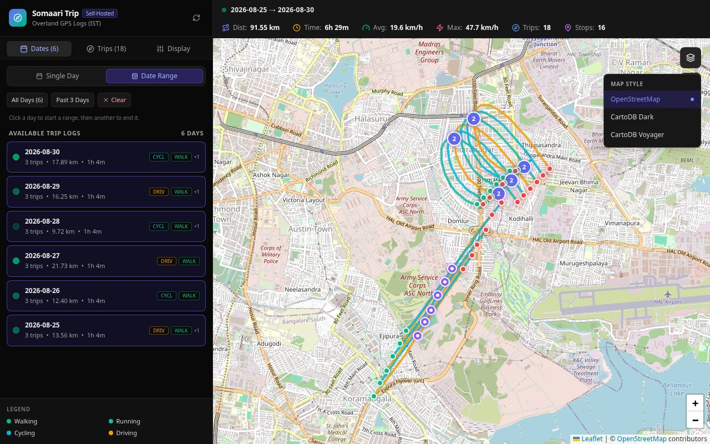

# Somaari Trip user guide

How to use the map once the app is running. For installing it and connecting Overland, see the [README](../README.md).

All screenshots use the built-in sample data (`SEED_SAMPLE_DATA=true`), not real location history.

## Contents
- [Signing in](#signing-in)
- [The screen](#the-screen)
- [Picking a day](#picking-a-day)
- [Several days at once](#several-days-at-once)
- [Trips](#trips)
- [Reading the map](#reading-the-map)
- [Stops](#stops)
- [Display settings](#display-settings)
- [Map style and controls](#map-style-and-controls)
- [On a phone](#on-a-phone)
- [Times and days](#times-and-days)
- [Troubleshooting](#troubleshooting)

## Signing in
Open `http://<server-ip>:18473` (the port is `SOMAARI_TRIP_PORT` if you changed it). The browser asks for a username and password: the `AUTH_USER` and the password you gave `npm run hash-password`. The browser remembers them until you close it.

Mistyping the password many times in a row gets you briefly rate limited; wait a few seconds and try again.

## The screen
- **Sidebar** (left) with three tabs: **Dates**, **Trips** and **Display**. The colour legend for trip modes is at the bottom.
- **Stats bar** (top): what you're looking at (a day or a range), then total distance, total trip time, average and maximum speed, number of trips and number of stops.
- **Map**: routes, start and end points, stops, and the map controls on the right.

The **↻** button next to the title reloads the day list and the current view. The app doesn't refresh by itself, so press it to see points Overland uploaded since you opened the page.

## Picking a day
The **Dates** tab lists every day that has data, newest first, and opens the newest day. Each row shows the date, number of trips, distance and duration, plus badges for the travel modes that day (`+1` means one more mode than fits). The dot on the left is brighter on days with more distance.

Click a day to show it on the map. The map zooms to fit that day's routes.

## Several days at once

Switch to **Date Range** at the top of the Dates tab, then either:
- use a preset: **All Days**, **Past 3 Days** or **Past 7 Days** (shown when there are enough days), or
- click a first day, then a last day. The days in between are included.

**Clear** removes the range. Switch back to **Single Day** for one day again. The stats bar and the trip list cover the whole range.

## Trips

The **Trips** tab lists the trips in the current view with their mode, start and end time, distance, duration and average speed.

- **Click a trip** to highlight it on the map and zoom to it. The stats bar shows its mode. Click it again to unselect it.
- **"N segments (gaps >5m)"** means the phone recorded nothing for more than 5 minutes during the trip (tunnel, phone off, no GPS). The route isn't drawn across the gap, so the trip shows as separate pieces.
- Clicking a route on the map selects that trip too. When routes are coloured by mode, it also opens a popup with distance, duration, average and maximum speed, and start and end time.

## Reading the map
- **Lines** are routes, coloured by trip mode (walking, running, cycling, driving and others; see the legend) or by speed (see [Display settings](#display-settings)).
- **Green dot**: where a trip starts. **Red dot**: where it ends. Hover over either for the time.
- **Purple ring**: a stop. A purple circle with a number is several stops close together.

## Stops

A stop is where the phone reported being stationary for at least 3 points in a row. Click one to see how long you were there, from and to when, the WiFi network the phone was on (if Overland reported one) and the battery level. Grouped stops list each stop in the group.

## Display settings

- **Polyline Color Mode**
  - **By Trip Mode**: one colour per trip, from its mode.
  - **By Speed (km/h)**: each stretch of route coloured from green (walking pace) through yellow to red (fast), with a legend at the bottom of the map. **Grey** means the phone didn't report a speed there. Hover over a stretch for its average speed and time.
- **Max Accuracy Filter** (10 to 100 m, default 50): drops GPS points less accurate than this. Lower it if routes zig-zag or jump around (e.g. indoors or between tall buildings); raise it if parts of a route are missing. It resets to 50 m when you reload the page.
- **Show Stationary Stops**: hides or shows the stop markers.
- **Filter By Mode**: click a mode to show only trips of that mode; click more modes to add them. The stats bar, trip list and stops follow the filter. Click the selected modes again to unselect them; with none selected, everything is shown.

## Map style and controls

On the right of the map:
- **Layers button**: choose the map style: **OpenStreetMap** (default), **CartoDB Dark** or **CartoDB Voyager**. Your choice is remembered in this browser.
- **Arrow button** (Fit to Trips): zoom back out to show every trip in the current view.
- **+ / −**: zoom. You can also scroll, pinch, or drag the map.

In Docker, map tiles go through your server and are cached there, so the map providers never see your browser or which areas you look at.

## On a phone
 

The sidebar is hidden on small screens. Tap the **☰** button (top left) to open it and **✕** to close it. Picking a day closes it for you. Everything else works the same as on a computer.

## Times and days
- All times are shown in **IST** (Asia/Kolkata, UTC+5:30).
- A "day" is an IST calendar day, midnight to midnight. A trip that runs past midnight appears partly on each day.

## Troubleshooting
- **"No CSV files found"**: there's no data yet. Check that `DATA_DIR` points at the right folder and that Overland is uploading (see the README's Overland section).
- **Today is missing or out of date**: press **↻**. Overland uploads in batches, so the last few minutes may not have arrived yet.
- **Gaps in a route**: the phone recorded nothing for more than 5 minutes, or the points there were less accurate than the **Max Accuracy Filter**. Try raising the filter.
- **Grey lines in speed mode**: the phone didn't report a speed for those points.
- **The browser keeps asking for the password**: check the username and password; if you mistyped several times, wait a few seconds.
